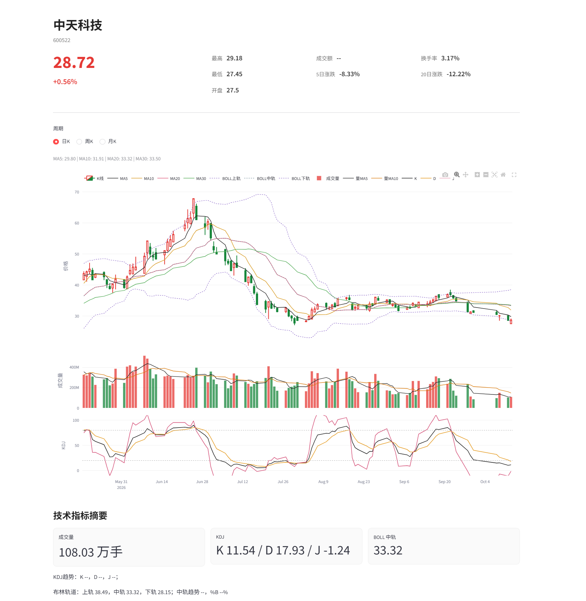
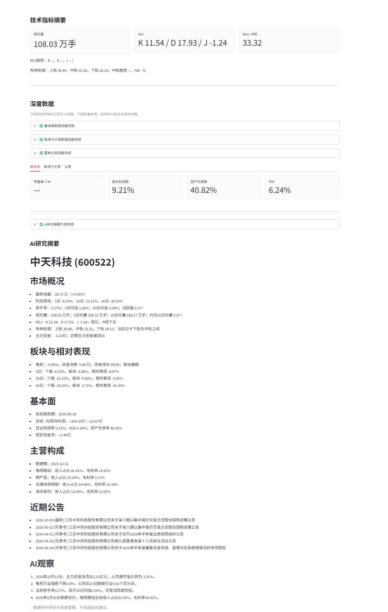
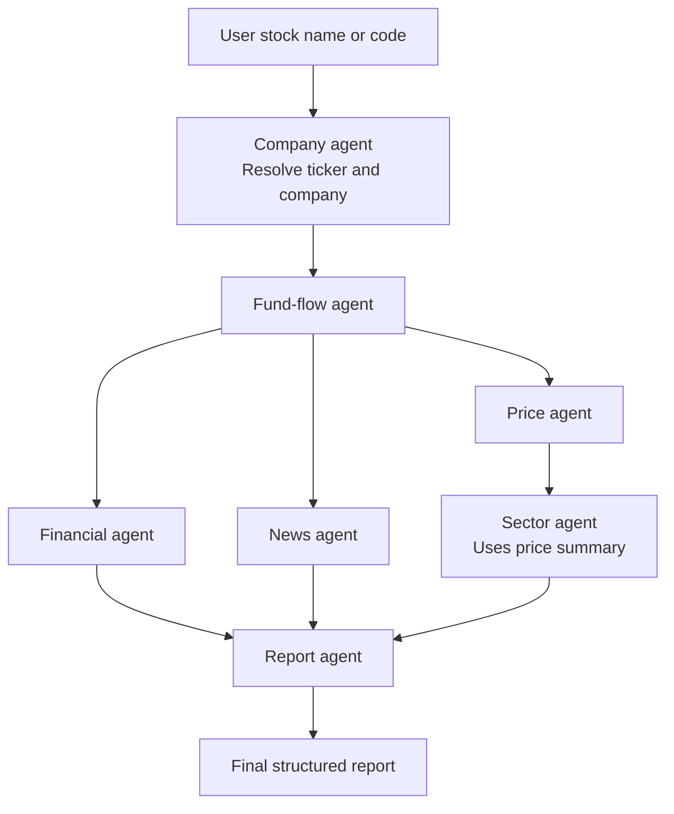
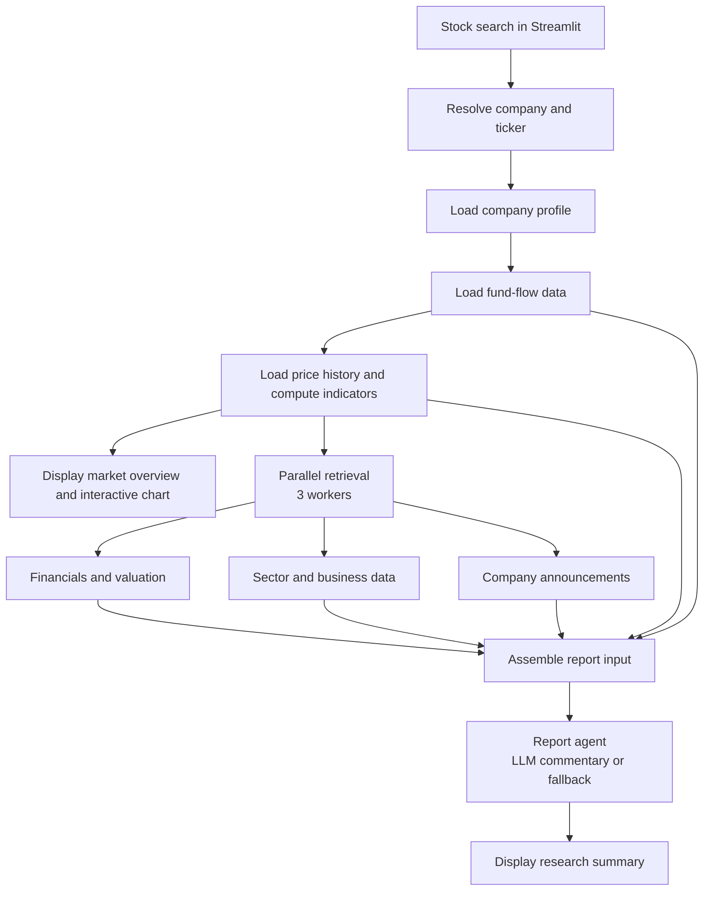

# Multi-Agent Equity Research System

**A task-oriented, LLM-assisted research platform for Chinese A-share stocks, combining financial-data tools, a LangGraph workflow, and an interactive Streamlit dashboard.**

**Stack:** Python · LangGraph · LangChain · Streamlit · Plotly · Pandas · OpenAI-compatible LLM API

> **Portfolio project · Chinese-language application, English documentation.** The interface and generated reports use Chinese because the product is designed around mainland China's A-share market. This README explains the technical design for an international audience.

## At a Glance

**What makes this project different:** It deliberately separates **deterministic financial computation**, **task-specific orchestration**, and **constrained language-model synthesis**. It also maintains a direct, responsiveness-oriented dashboard execution path alongside the reusable LangGraph research workflow.


- **Unified equity research:** Look up an A-share company and explore price history, technical signals, financial metrics, capital flows, industry performance, and recent announcements.
- **Task-oriented orchestration:** A LangGraph workflow organizes specialized research functions and passes structured results through a shared state.
- **LLM-assisted synthesis:** A report function extracts a bounded set of retrieved metrics, generates constrained commentary through an LLM when configured, and assembles a structured research report.
- **Optimized dashboard:** A separate Streamlit path prioritizes early chart rendering, caches external data, and concurrently loads slower research sections.
- **Measured responsiveness:** In a six-query, same-stock-order pilot benchmark, the optimized path reduced mean server-side time to the first chart from **143.82 s to 28.92 s (79.9% lower)**. Full-script completion time was essentially unchanged; see [Performance Benchmark](#performance-benchmark-six-matched-queries) for details and limitations.

## Application Walkthrough

These are **actual screenshots of the Streamlit application**, using **Zhongtian Technology (600522)** as an example. The product interface is in Chinese because it targets the Chinese A-share market; the explanations below translate the main UI elements for an international technical audience. **Values are historical snapshots from the screenshots, not live quotes or recommendations.**

### 1. Market overview and interactive technical chart

[](assets/market-dashboard.png)

*Figure 1 — Market dashboard. Click the screenshot to open the full-size image.*

The first view is designed to give users **useful market information before the slower research requests finish**:

| What appears in the screenshot | What it does |
| --- | --- |
| **Stock identity & quote** (中天科技 / 600522) | Resolves the company's name/code and displays the latest retrieved close, daily change, session high/low/open, turnover, and recent returns. |
| **Candlestick chart** (K线) | Provides daily, weekly, and monthly views of historical prices so users can inspect different time horizons. |
| **Moving averages & Bollinger Bands** (均线 / 布林轨道) | Overlays MA5/10/20/30 and upper/middle/lower Bollinger bands on the price chart. |
| **Volume & KDJ** (成交量 / KDJ) | Adds linked trading-volume and KDJ panels to show trading activity and momentum alongside price action. |

**Engineering detail:** `app_fast.py` loads the price history and computes technical indicators with Python tools, prepares the selected chart frequency via `tools/chart_tools.py`, and renders a multi-panel Plotly figure. These charts are **data visualization and descriptive technical analysis**, not ML-based price forecasts.

### 2. Fundamentals, data-loading progress, and AI-assisted research

[](assets/research-summary.png)

*Figure 2 — Lower part of the application. Click to read the full-size research report.*

After the initial market chart appears, the application continues with **deeper company research**:

| Section | What the screenshot demonstrates |
| --- | --- |
| **Technical summary** (技术指标摘要) | At-a-glance volume, KDJ, and Bollinger-midline metrics, complementing the interactive chart. |
| **Deep-data status** (深度数据) | Separate progress indicators for fundamentals, sector/business data, and announcements. A slow external provider does not leave the user staring at an unexplained blank page. |
| **Fundamentals** (基本面) | Report-period financial metrics such as operating margin, return on equity, debt-to-assets ratio, and valuation when available. A dash (`—`) indicates an unavailable field, not a measured zero. |
| **Sector & relative performance** (板块与相对表现) | Compares the stock's returns with its industry/sector over multiple horizons and reports any retrieved sector-level fund-flow context. |
| **Business mix & announcements** (主营构成 / 近期公告) | Summarizes available product revenue shares and margins separately from dated company announcements. |
| **AI research summary** (AI研究摘要 / AI观察) | Presents a fixed-format research report assembled from retrieved data, followed by a short model-generated observation **when an LLM is configured**, or a deterministic fallback. |

**Important distinction:** The numbers and report headings are constructed from tool results in Python. The LLM receives a selected structured JSON payload and is asked to provide **brief qualitative observations**, not to calculate missing figures, predict stock prices, or recommend trades. See [LLM-Assisted Report Generation](#llm-assisted-report-generation) for the exact approach.

### User journey

1. **Search** by Chinese stock name or ticker; resolve the company identifier.
2. **Explore market data**: see the quote, interactive candlestick chart, volume, and technical indicators.
3. **Load detailed research**: fetch fundamentals, sector/business information, and recent announcements concurrently, with per-section status feedback.
4. **Read the report**: assemble the structured findings and optional, grounded LLM observations into a Chinese-language research summary.

## Problem and Approach

Company research involves collecting information from fragmented sources: market prices, financial statements, valuation metrics, fund flows, sector data, and announcements. The challenge is not only retrieval, but also organizing these heterogeneous inputs into a readable, consistent research view.

This application separates three responsibilities:

1. **Retrieve and compute** financial observations with Python tools.
2. **Coordinate** dependent research tasks through explicit workflow functions and a shared state.
3. **Synthesize** selected structured information into a report, using an LLM only for the qualitative observation section.

It is **not** a price-prediction model, automated trading system, or a set of autonomous LLM agents independently deciding what trades to make.

## System Architecture

The repository provides **two execution paths**. Both use the same underlying research utilities, but they make different orchestration choices.

### 1. LangGraph research workflow — `graph.py`



`graph.py` compiles a `StateGraph` whose nodes exchange values through the typed `ResearchState` defined in `state.py`. Financial, price, and news tasks branch after fund-flow retrieval; sector analysis depends on price information; report synthesis joins the required branches. Errors are accumulated in a shared list through a state reducer.

### 2. Streamlit dashboard — `app_fast.py`



**Important implementation detail:** `app_fast.py` calls data tools directly and invokes `report_agent` after data retrieval. **It does not execute the full LangGraph graph.** The initial stock/company/fund-flow/price steps are sequential; the slower financial, sector, and news sections are then requested concurrently.

### Why two execution paths?

The original research workflow was designed around **completing a dependency-aware analysis**: LangGraph coordinates company identification, financial research, market data, sector context, news, and report generation. This is a useful design for reusable, structured research execution, but waiting for the whole analysis before showing the market chart creates an unnecessary delay for an interactive application.

The newer `app_fast.py` addresses a different requirement: **make the first useful result available sooner**, even when external fundamental-data or announcement services are slow.

| Design priority | LangGraph research workflow (`graph.py`) | Optimized dashboard (`app_fast.py`) |
| --- | --- | --- |
| Main objective | Coordinate a complete research pipeline with explicit task dependencies | Minimize waiting time before the user can explore price charts |
| Execution strategy | Execute graph nodes and join research branches before the report is complete | Fetch initial market context, render the chart, then retrieve deeper sections |
| Data dependencies | Typed `ResearchState` and graph edges | Direct tool calls, then three concurrent deep-data tasks |
| Reporting | Report agent assembles the final structured result | The same report-generation logic is reused after detailed retrieval |
| User experience | Better suited to programmatic full-research execution | Show market results and loading status while deeper analysis proceeds |

This is a **workflow and interface scheduling decision**, not a claim that the LLM generates research faster or that every external API has become faster. The dashboard intentionally uses a different orchestration path instead of running the full LangGraph graph.

The underlying design also reflects three principles: **separation of concerns** (specialized tool functions), **explicit dependencies** (such as sector analysis requiring price context), and **deterministic computations before LLM synthesis** (financial metrics are calculated with Python tools rather than invented by a model).

The word *agent* here means a **task-specific workflow function**, not necessarily an independently planning or reasoning LLM agent. In the current implementation, **`report_agent` is the LLM-using component**.

## Research Components

| Component | Responsibility | Key modules |
| --- | --- | --- |
| Company agent | Resolve company names/codes and retrieve company details | `agents.py`, `tools/stock_search.py`, `tools/company_tools.py` |
| Fund-flow agent | Retrieve capital-flow and turnover information | `agents.py`, `tools/fund_flow_tools.py` |
| Financial agent | Retrieve financial metrics and valuation information | `agents.py`, `tools/financial_tools.py`, `tools/valuation_tools.py` |
| Price agent | Retrieve market history and compute technical indicators | `agents.py`, `tools/price_tools.py`, `tools/technical_tools.py` |
| News agent | Retrieve recent news and company announcements | `agents.py`, `tools/news_tools.py` |
| Sector agent | Retrieve industry information and stock-versus-sector performance | `agents.py`, `tools/sector_tools.py` |
| Report agent | Build a bounded model input, generate observations, and assemble a Markdown report | `agents.py` |
| Chart utilities | Prepare chart-ready data for interactive visualization | `tools/chart_tools.py`, `app_fast.py` |

## LLM-Assisted Report Generation

The report pipeline in `agents.py` is intentionally **data-first**:

1. **Structured input:** `_build_ai_payload()` selects available market returns, technical signals, fund-flow observations, financial metrics, sector comparisons, business composition, and recent announcement metadata.
2. **Constrained interpretation:** `report_agent()` asks for three to four short Chinese observations based **only on the supplied JSON**. The prompt prohibits invented financial facts, unsupported fundamental comparisons, price targets, trading instructions, and price predictions. It also distinguishes overall fund flow from main-force fund flow and requires dates for referenced announcements.
3. **Deterministic document construction:** `_build_report()` generates fixed report sections for market overview, sector performance, fundamentals, business composition, announcements, and AI observations.
4. **Graceful fallback:** If the LLM is not configured or its call fails, `_build_fallback_observation()` produces a limited observation from available structured signals.

**Model configuration:** The implementation uses `langchain_openai.ChatOpenAI` through configurable `OPENAI_API_KEY`, `OPENAI_BASE_URL`, and `OPENAI_MODEL` variables. The current default model identifier in code is `zai.glm-4.7-flash`; the actual provider depends on the configured compatible endpoint. The integration uses an OpenAI-compatible API interface rather than a provider-specific SDK.

This is **prompt-level grounding**, not retrieval-augmented generation (RAG) with a vector database or a guarantee against hallucinations. LLM observations still require verification before real-world use.

## Engineering Case Study: Improving Dashboard Responsiveness

### Problem: delayed first useful result

The original application prioritized assembling the complete research response. Because it depends on several external financial-data services and report generation, users could wait a substantial amount of time before reaching the interactive price chart—even when the price data itself did not require all of the deeper financial, sector, or news requests.

For an interactive research dashboard, **time to first useful result** matters separately from **time to complete all analysis**. A user should be able to inspect market movement and technical indicators while slower information is still being collected.

### Solution: a chart-first execution path

Rather than replacing the LangGraph research pipeline, `app_fast.py` provides a user-facing execution path with the following changes:

| Engineering decision | Implementation | Intended benefit |
| --- | --- | --- |
| **Prioritize market data** | Retrieve the stock identity, company context, fund-flow information, and price history; compute indicators and render the Plotly chart before the deep-data stage | Make an actionable research *view* available without waiting for every source |
| **Parallelize independent deep-data requests** | `ThreadPoolExecutor(max_workers=3)` retrieves financial/valuation data, sector/business data, and recent announcements concurrently | Avoid unnecessary serialization of independent network-bound requests |
| **Cache repeated requests** | Streamlit `@st.cache_data` with source-specific TTLs | Avoid some repeated external calls when cached results remain valid |
| **Render in stages** | Display quote, candlesticks, volume, and technical indicators before the deeper report; show `st.status` progress indicators | Give users visible progress and access to earlier results |
| **Handle partial failures** | Catch selected upstream errors and preserve already obtained market data | Keep useful sections accessible when a slower provider fails |

The dashboard uses **120-second TTLs** for price and fund-flow queries, **300 seconds** for stock resolution, **600 seconds** for sector and news queries, and **1,800 seconds** for company and financial data. This reduces redundant calls at the cost of some potential data staleness.

The **chart-first reordering** is the most direct explanation for the improvement in chart availability. The three concurrent deep-data requests start **after** the chart is generated, so their parallelism should **not** be credited as the direct cause of the chart-loading improvement.

### Performance Benchmark: Six Matched Queries

A local pilot benchmark compared the original Streamlit entry point (`app.py`) with the optimized dashboard (`app_fast.py`). **Six corresponding queries were searched in the same stock order** across the two versions. The first three tickers were not retained in the manual timing notes; the final three are shown by ticker.

The timing instrumentation used Python's `time.perf_counter()` inside temporary, instrumented app copies:

- **Chart ready:** elapsed **server-side** time from the Search-button run to completion of the first `st.plotly_chart(...)` call. This is a code checkpoint, **not** a browser first-paint measurement.
- **Full script:** elapsed server-side time from the same Search-button run to the end of the Streamlit script; this is a completion-time proxy, not a validated equality check of the two reports.

All values are in seconds (**lower is better**).

| Matched query | Original chart | Optimized chart | Original full script | Optimized full script |
| --- | ---: | ---: | ---: | ---: |
| Trial 1 (ticker not recorded) | 213.95 | 83.52 | 214.01 | 202.26 |
| Trial 2 (ticker not recorded) | 119.49 | 18.01 | 119.52 | 124.26 |
| Trial 3 (ticker not recorded) | 157.97 | 19.06 | 158.01 | 164.46 |
| 300750 | 78.82 | 16.94 | 78.86 | 72.75 |
| 600418 | 144.82 | 17.72 | 144.85 | 148.98 |
| 000725 | 147.84 | 18.24 | 147.90 | 155.65 |
| **Mean (6 queries)** | **143.82** | **28.92** | **143.86** | **144.73** |

**Observed reduction in mean time to first chart:**

$$
\frac{143.815 - 28.915}{143.815} \times 100 \approx \boxed{79.9\%}
$$

This corresponds to **114.9 seconds less waiting on average**, or approximately **5.0× the original chart-availability speed** for these six runs. The median chart-ready time was **146.33 s** for the original version versus **18.13 s** for the optimized version.

**Crucially, full-script completion did not improve:** the observed means were **143.86 s** (original) and **144.73 s** (optimized). This supports a narrower, more useful conclusion: **the application displays its initial market analysis much earlier, while deeper research still takes roughly the same total time.**

#### Interpretation and benchmark limitations

- These are **six exploratory, matched-query observations**, not a controlled production benchmark. Stock order was matched, but cold/warm cache conditions, external API response times, network variability, and provider rate limits were not fully controlled.
- The two paths have different scheduling and orchestration, so the observed gain reflects the **end-to-end chart-first experience**; it is **not** a measured speedup attributable solely to threading, caching, or LangGraph overhead.
- The timing checkpoints measure **server-side execution**, not exact browser-visible rendering or user interaction latency.
- Report completeness and numerical equivalence were not independently assessed for each run. The results do not demonstrate improved forecast accuracy, data correctness, or trading performance.

For these reasons, **79.9%** is reported as the **observed mean reduction for this six-query test**, not a guaranteed improvement for all A-share stocks or network conditions.

## Evaluation and Reproducibility

The benchmark above documents real measurements of **market-chart availability** and **script completion**. Additional evaluation is needed for correctness, data coverage, and robust performance generalization.

| Evaluation dimension | Status / next step |
| --- | --- |
| Time to first usable chart | **Measured:** six same-order query pairs, with raw per-query timings shown above |
| End-to-end script time | **Measured:** six same-order query pairs; no meaningful average improvement observed |
| Cold-vs-warm cache comparison | **Not controlled:** repeat tests with cache resets and recorded cache state |
| Data-source coverage | **Not yet benchmarked:** log missing and successful sections for a wider stock sample |
| Failure handling | **Partially implemented:** add injected provider failures and test what remains visible |
| LLM factual consistency | **Not yet benchmarked:** manually compare generated observations against the supplied JSON payload |

To reproduce the timing approach, instrument separate copies of `app.py` and `app_fast.py` with `time.perf_counter()` at the query handler, immediately after the first `st.plotly_chart(...)`, and at the end of the script; then record the same tickers in the same order. For a stronger follow-up study, alternate version order, specify cache state, repeat each stock multiple times, and record the environment and API response failures.

**The project does not claim predictive accuracy, investment performance, or trading profitability.**

## Project Structure

```text
a-share-stock-research/
├── agents.py                    # Task-specific research nodes and report generation
├── graph.py                     # LangGraph StateGraph and run_research()
├── state.py                     # Shared typed research state
├── app_fast.py                  # Streamlit dashboard used for the screenshots
├── app.py                       # Alternative app entry (not documented here)
├── main.py                      # Additional entry point
├── tools/
│   ├── stock_search.py
│   ├── company_tools.py
│   ├── financial_tools.py
│   ├── price_tools.py
│   ├── technical_tools.py
│   ├── fund_flow_tools.py
│   ├── valuation_tools.py
│   ├── sector_tools.py
│   ├── news_tools.py
│   └── chart_tools.py
├── assets/
│   ├── market-dashboard.png     # Market and technical analysis screenshot
│   └── research-summary.png     # Fundamentals and AI report screenshot
├── .env.example                 # Safe configuration template
├── requirements.txt
├── .gitignore
└── README.md
```

## Getting Started

### Prerequisites

- Python and `pip` (use a version compatible with the repository's `requirements.txt`)
- An internet connection for the financial-data tools
- **Optional:** an API key and endpoint for an OpenAI-compatible chat model

### Install

```bash
git clone https://github.com/Barrygyx/multi-agent-equity-research.git
cd multi-agent-equity-research
python -m venv .venv
```

Activate the virtual environment:

**Windows PowerShell**

```powershell
.\.venv\Scripts\Activate.ps1
python -m pip install -r requirements.txt
```

**macOS / Linux**

```bash
source .venv/bin/activate
python -m pip install -r requirements.txt
```

### Configure optional LLM access

Copy `.env.example` to `.env` and replace example values with your actual credentials:

```dotenv
OPENAI_API_KEY=your_api_key_here
OPENAI_BASE_URL=https://your-openai-compatible-endpoint/v1
OPENAI_MODEL=zai.glm-4.7-flash
```

The endpoint and model must be supported by your chosen service. **Do not commit `.env`, credentials, tokens, or secrets.** If no key is configured, the report agent uses its limited deterministic observation fallback.

### Run the interactive dashboard

```bash
streamlit run app_fast.py
```

Enter a Chinese company name or stock code and select **查询** (Search). The sidebar and report content are in Chinese.

### Run the LangGraph workflow from Python

```python
from graph import run_research

result = run_research("600522")
print(result.get("final_report", ""))
print(result.get("errors", []))
```

This executes `graph.py`, **not** the optimized Streamlit dashboard.

## Limitations and Next Steps

- **External data dependencies:** Provider availability, rate limits, stale data, and schema changes may affect retrieval or completeness.
- **Chinese-market scope:** UI copy, financial terminology, and report output are designed for Chinese A-share research rather than an international equity universe.
- **Model limitations:** Prompt restrictions and bounded JSON inputs reduce opportunities for invented commentary but do not guarantee factual accuracy.
- **Orchestration trade-off:** The dashboard and LangGraph graph are separate execution paths; future work could unify shared orchestration without sacrificing early rendering.
- **Evaluation gaps:** The six-query responsiveness benchmark is exploratory; future work should control cache state, expand the sample, log stage-level latencies and per-source coverage, and add a human-reviewed factual consistency set.
- **Traceability:** Add observation-level source links and data timestamps where the underlying tools can supply them.

## Disclaimer

**For educational and research use only.** The application may return incomplete, delayed, or incorrect information. It does not provide investment advice, price predictions, or guarantees of returns.
