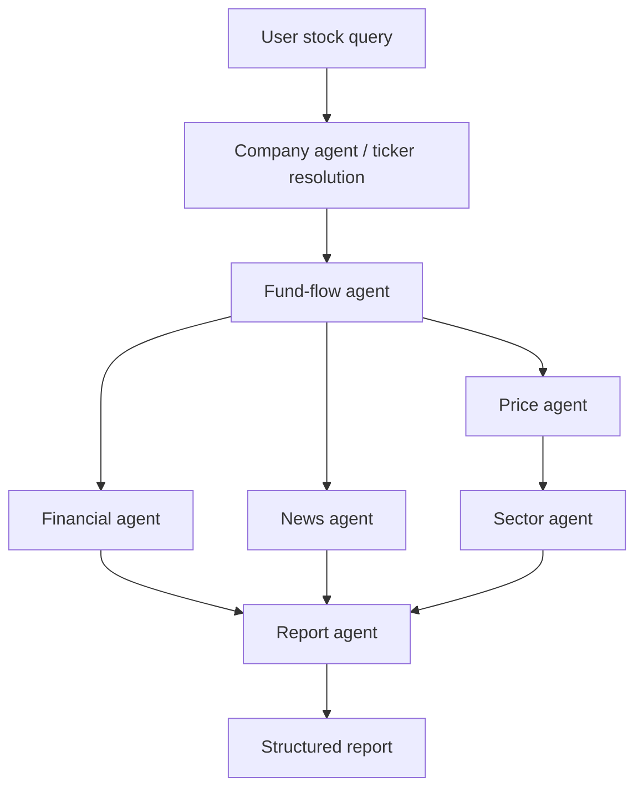
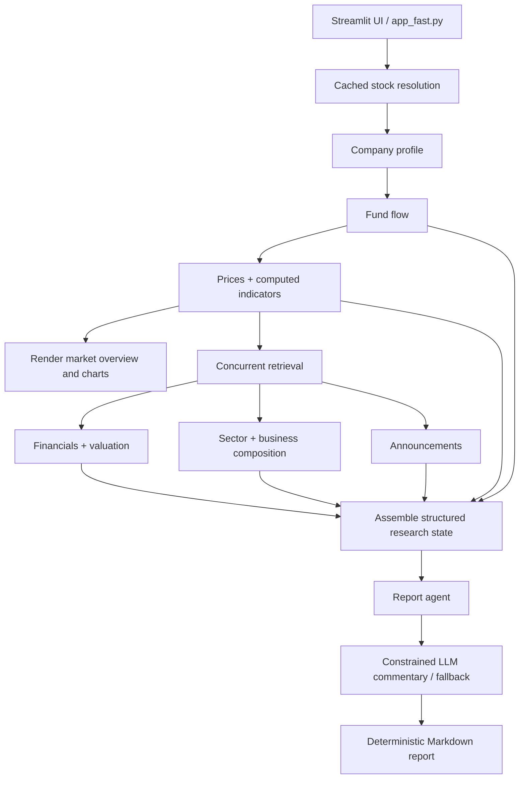

# Multi-Agent Equity Research System

**An LLM-assisted equity research application for Chinese A-share stocks, combining structured financial data, a LangGraph research workflow, and an interactive Streamlit dashboard.**

`Python` · `LangGraph` · `LangChain` · `Streamlit` · `Plotly` · `Pandas` · `LLM API`

> **Portfolio project:** Built to explore how task-oriented research workflows, financial-data tools, and constrained LLM synthesis can support equity research. The application interface and generated reports are in Chinese because its target market is mainland China; this documentation is in English.

## Overview

Researching a listed company often requires checking separate sources for price history, technical indicators, financial statements, valuation, capital flows, sector performance, and announcements. This project brings those inputs into a single workflow and presents them in an interactive stock-research dashboard.

The implementation separates **data retrieval and numerical computation** from **language-model interpretation**. Python tools supply structured observations; an LLM generates a short qualitative commentary based on a bounded payload; and a deterministic report builder composes the final research summary.

**What this project is:** a financial-data integration and LLM-assisted research application. **What it is not:** a trained stock-price forecasting model, automated trading system, or a collection of autonomous LLM agents independently making investment decisions.

## Features

- **A-share stock lookup:** Resolve a company name or stock code into identifying information for downstream retrieval.
- **Market overview:** Display recent price changes, historical performance, turnover, and volume statistics.
- **Interactive technical charts:** Plot daily, weekly, or monthly candlesticks with moving averages, Bollinger Bands, volume, and KDJ indicators.
- **Fundamentals and valuation:** Aggregate available financial metrics, business composition, and valuation data.
- **Capital-flow and sector context:** Show available capital-flow signals and stock-versus-sector relative performance.
- **Company announcements:** Present recent announcements with available publication dates and metadata.
- **LLM-assisted research summary:** Generate concise observations from structured market, fundamental, sector, flow, and announcement data.
- **Responsive loading:** Cache queries with data-dependent expiration windows, load selected data sources concurrently, and show per-section loading status.

## Demo

<!-- Replace with an actual screenshot or GIF after creating assets/ -->

**Dashboard preview:** Add a screenshot at `assets/dashboard.png` and uncomment the line below.

<!--  -->

**Suggested demo:** A 60–90-second recording showing stock lookup, price/technical charts, financial and sector tabs, and final research commentary. English captions are sufficient; the Chinese user interface can remain unchanged.

## Architecture

The repository contains **two related execution paths**:

1. **LangGraph workflow (`graph.py`)** — a compiled `StateGraph` with task-specific nodes sharing a typed `ResearchState`.
2. **Optimized interactive dashboard (`app_fast.py`)** — invokes data tools directly, uses Streamlit caches and a thread pool for selected independent requests, then calls the shared `report_agent` for report generation. **This dashboard does not execute the entire LangGraph graph.**

### LangGraph research workflow



In `graph.py`, the financial, price, and news branches start after fund-flow retrieval; sector research depends on price data; and the report stage waits for the financial, news, and sector branches. Shared intermediate outputs are carried in `ResearchState` (`state.py`), with an additive reducer for error messages.

### Interactive dashboard path



The dashboard prioritizes making market information visible before deeper sections are ready. A `ThreadPoolExecutor(max_workers=3)` retrieves financial, sector, and news data concurrently after the initial stock and price data have loaded. Each section displays its own completion or failure status.

## Agents and Tools

The term **agent** in this project refers to a task-specific workflow node or research function. Most nodes call deterministic Python data tools; **the report agent is the node that invokes an LLM**. These are not seven independent autonomous reasoning agents.

| Workflow component | Responsibility | Main implementation |
| --- | --- | --- |
| Company agent | Resolve a stock query and obtain company details | `agents.py`, `tools/stock_search.py`, `tools/company_tools.py` |
| Fund-flow agent | Retrieve stock-level capital-flow information | `agents.py`, `tools/fund_flow_tools.py` |
| Financial agent | Retrieve financial data and valuation metrics | `agents.py`, `tools/financial_tools.py`, `tools/valuation_tools.py` |
| Price agent | Retrieve price history and market summaries | `agents.py`, `tools/price_tools.py` |
| News agent | Retrieve recent company news/announcements | `agents.py`, `tools/news_tools.py` |
| Sector agent | Retrieve industry context and relative performance | `agents.py`, `tools/sector_tools.py` |
| Report agent | Build a structured LLM input, generate constrained observations, and assemble the report | `agents.py` |

Additional modules include `tools/technical_tools.py` for technical indicators and `tools/chart_tools.py` for chart-ready data.

## LLM Design and Grounding

The report agent uses `ChatOpenAI` from `langchain_openai` with configurable `OPENAI_API_KEY`, `OPENAI_BASE_URL`, and `OPENAI_MODEL` environment variables. The default configured model identifier in `agents.py` is `zai.glm-4.7-flash`; the API endpoint is configurable rather than hard-coded to a specific provider.

The process is intentionally split into three stages:

1. **Extract and normalize:** `_build_ai_payload()` selects a compact set of available financial metrics, price returns, technical indicators, capital-flow observations, sector comparisons, business information, and recent announcement metadata.
2. **Constrain commentary:** The prompt requests three or four short Chinese observations (150 Chinese characters or fewer in total) grounded only in supplied data. It explicitly prohibits invented facts, unsupported claims about company fundamentals, price targets, buy/sell instructions, and probabilistic predictions. It also distinguishes overall money flow from *main-force* flow and requires dates when discussing announcements.
3. **Build the report:** `_build_report()` assembles deterministic sections for market overview, sector performance, fundamentals, business composition, recent announcements, and the generated observations.

If the model is unconfigured or the invocation fails, the system falls back to a short observation assembled from available structured signals. **Prompt constraints reduce unsupported generation but do not guarantee factual correctness.** The system does not currently demonstrate a formal hallucination benchmark.

## Engineering Decisions

| Challenge | Implemented approach | Trade-off |
| --- | --- | --- |
| Multiple financial endpoints can be slow | Concurrent loading of the financial, sector, and news sections in `app_fast.py` | Overall latency still depends on upstream API responsiveness |
| Repeated queries can trigger unnecessary retrieval | Streamlit `@st.cache_data` with different TTLs (120–1,800 seconds in the provided dashboard code) | Cached data can be temporarily stale |
| Users otherwise wait for the entire research pipeline | Show price information and charts before deeper data, with individual status indicators | Some sections may remain unavailable while others work |
| LLM-generated numbers may be unsupported | Calculate numbers in Python and pass selected structured values to the model | Commentary still needs human judgment |
| External services or LLM calls may fail | Catch selected retrieval errors and provide a fallback observation when model generation fails | Coverage and completeness can vary by stock and data source |

No speedup factor or accuracy figure is claimed here because a reproducible benchmark was not supplied.

## Project Structure

```text
a-share-stock-research/
├── agents.py                 # Task-specific research functions + report synthesis
├── graph.py                  # LangGraph StateGraph and graph entry point
├── state.py                  # Shared typed research state
├── app_fast.py               # Optimized Streamlit dashboard (recommended UI entry)
├── app.py                    # Additional Streamlit application version
├── main.py                   # Additional entry point
├── tools/
│   ├── __init__.py
│   ├── stock_search.py
│   ├── company_tools.py
│   ├── financial_tools.py
│   ├── price_tools.py
│   ├── technical_tools.py
│   ├── valuation_tools.py
│   ├── fund_flow_tools.py
│   ├── sector_tools.py
│   ├── news_tools.py
│   └── chart_tools.py
├── requirements.txt
├── .gitignore
└── README.md
```

## Getting Started

### 1. Prerequisites

- Python and pip (use a Python version compatible with `requirements.txt`)
- Internet access to the configured financial-data sources
- Optional: access credentials and a compatible endpoint for LLM commentary

### 2. Clone and install

```bash
git clone https://github.com/YOUR_USERNAME/multi-agent-equity-research.git
cd multi-agent-equity-research
python -m venv .venv
```

**Windows PowerShell:**

```powershell
.\.venv\Scripts\Activate.ps1
pip install -r requirements.txt
```

**macOS / Linux:**

```bash
source .venv/bin/activate
pip install -r requirements.txt
```

### 3. Configure the LLM (optional)

Create a local `.env` file in the project root:

```dotenv
OPENAI_API_KEY=your_api_key
OPENAI_BASE_URL=https://your-compatible-endpoint/v1
OPENAI_MODEL=zai.glm-4.7-flash
```

These are the environment-variable names read by the uploaded `agents.py`. Set the endpoint and model to match your actual provider. **Never commit `.env` or real credentials.** Without an API key, the report agent uses its deterministic fallback observations.

### 4. Run the dashboard

```bash
streamlit run app_fast.py
```

Enter a Chinese stock name or a valid A-share stock code in the sidebar and click **查询** (Search).

### 5. Run the LangGraph workflow programmatically

```python
from graph import run_research

result = run_research("002226")
print(result.get("final_report", ""))
```

This calls the `StateGraph` defined in `graph.py`, **not** the optimized Streamlit execution path.

> **Reproducibility note:** The tool implementations and `requirements.txt` have not been reviewed as part of this README draft. Their external data dependencies, package versions, and any additional setup requirements should be verified before describing a clean install as tested.

## Limitations

- The application is designed for **Chinese A-share equities** and uses a Chinese-language interface and reporting format.
- External financial-data availability, rate limits, and schemas can affect completeness and runtime.
- Caches improve responsiveness at the cost of short-lived data staleness.
- The research report is an information-synthesis tool, not an independently verified financial analysis or investment recommendation.
- The current repository does not establish measured prediction quality, investment returns, or a systematic evaluation of LLM factuality.
- The supplied optimized UI uses direct tool orchestration rather than executing the full LangGraph research workflow.

## Potential Improvements

- Add repeatable integration tests with mocked financial-data responses.
- Evaluate report factual consistency against source data using a small manually reviewed stock set.
- Record per-stage execution times, cache hit rates, and data-source failure rates.
- Add source links and observation-level provenance to the generated commentary where supported by upstream data.
- Optionally provide English UI labels or annotated screenshots for non-Chinese-speaking reviewers.

## Disclaimer

This project is for **educational and research purposes only**. Outputs may be incomplete, delayed, or incorrect and should not be treated as financial advice. No trading recommendations or guarantees of returns are provided.
