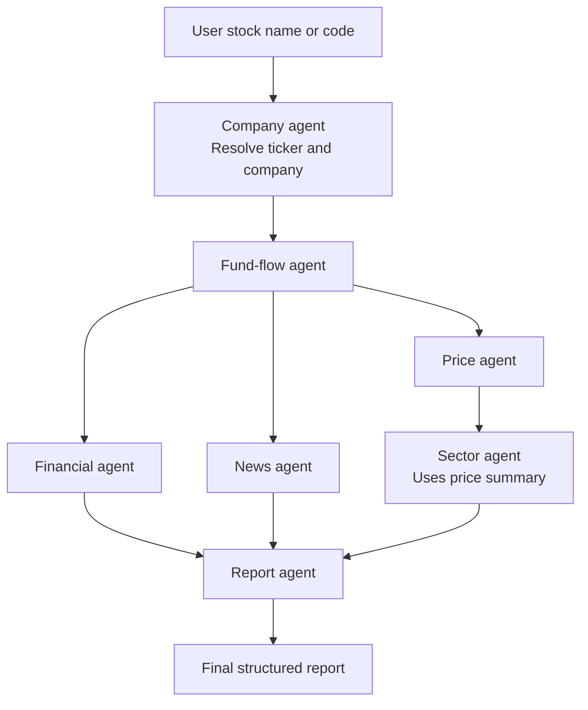
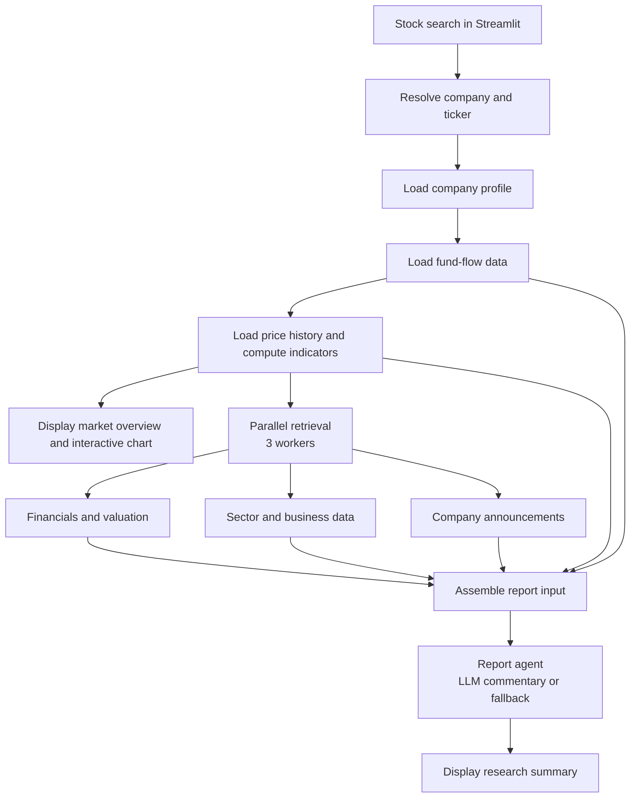

# Multi-Agent Equity Research System

**A task-oriented, LLM-assisted research platform for Chinese A-share stocks, combining financial-data tools, a LangGraph workflow, and an interactive Streamlit dashboard.**

**Stack:** Python · LangGraph · LangChain · Streamlit · Plotly · Pandas · OpenAI-compatible LLM API

> **Portfolio project · Chinese-language application, English documentation.** The interface and generated reports use Chinese because the product is designed around mainland China's A-share market. This README explains the technical design for an international audience.

## At a Glance

**What makes this project different:** It deliberately separates **deterministic financial computation**, **task-specific orchestration**, and **constrained language-model synthesis**. It also maintains a direct, responsiveness-oriented dashboard execution path alongside the reusable LangGraph research workflow.


- **Unified equity research:** Look up an A-share company and explore price history, technical signals, financial metrics, capital flows, industry performance, and recent announcements.
- **Task-oriented orchestration:** A LangGraph workflow organizes specialized research functions and passes structured results through a shared state.
- **LLM-assisted synthesis:** A report function extracts a bounded set of retrieved metrics, generates constrained commentary through an LLM when configured, and assembles a structured research report.
- **Optimized dashboard:** A separate Streamlit path prioritizes early chart rendering, caches external data, and concurrently loads slower research sections.

## Application Walkthrough

These are **actual screenshots of the Streamlit application**, using **Zhongtian Technology (600522)** as an example. The product interface is in Chinese because it targets the Chinese A-share market; the explanations below translate the main UI elements for an international technical audience. **Values are historical snapshots from the screenshots, not live quotes or recommendations.**

### 1. Market overview and interactive technical chart

[](assets/market-dashboard.png)

*Figure 1 — Market dashboard. Click the screenshot to open the full-size image.*

The first view is designed to give users **useful market information before the slower research requests finish**:

| What appears in the screenshot | What it does |
| --- | --- |
| **Stock identity & quote** (中天科技 / 600522) | Resolves the company's name/code and displays the latest retrieved close, daily change, session high/low/open, turnover, and recent returns. |
| **Candlestick chart** (K线) | Provides daily, weekly, and monthly views of historical prices so users can inspect different time horizons. |
| **Moving averages & Bollinger Bands** (均线 / 布林轨道) | Overlays MA5/10/20/30 and upper/middle/lower Bollinger bands on the price chart. |
| **Volume & KDJ** (成交量 / KDJ) | Adds linked trading-volume and KDJ panels to show trading activity and momentum alongside price action. |

**Engineering detail:** `app_fast.py` loads the price history and computes technical indicators with Python tools, prepares the selected chart frequency via `tools/chart_tools.py`, and renders a multi-panel Plotly figure. These charts are **data visualization and descriptive technical analysis**, not ML-based price forecasts.

### 2. Fundamentals, data-loading progress, and AI-assisted research

[](assets/research-summary.png)

*Figure 2 — Lower part of the application. Click to read the full-size research report.*

After the initial market chart appears, the application continues with **deeper company research**:

| Section | What the screenshot demonstrates |
| --- | --- |
| **Technical summary** (技术指标摘要) | At-a-glance volume, KDJ, and Bollinger-midline metrics, complementing the interactive chart. |
| **Deep-data status** (深度数据) | Separate progress indicators for fundamentals, sector/business data, and announcements. A slow external provider does not leave the user staring at an unexplained blank page. |
| **Fundamentals** (基本面) | Report-period financial metrics such as operating margin, return on equity, debt-to-assets ratio, and valuation when available. A dash (`—`) indicates an unavailable field, not a measured zero. |
| **Sector & relative performance** (板块与相对表现) | Compares the stock's returns with its industry/sector over multiple horizons and reports any retrieved sector-level fund-flow context. |
| **Business mix & announcements** (主营构成 / 近期公告) | Summarizes available product revenue shares and margins separately from dated company announcements. |
| **AI research summary** (AI研究摘要 / AI观察) | Presents a fixed-format research report assembled from retrieved data, followed by a short model-generated observation **when an LLM is configured**, or a deterministic fallback. |

**Important distinction:** The numbers and report headings are constructed from tool results in Python. The LLM receives a selected structured JSON payload and is asked to provide **brief qualitative observations**, not to calculate missing figures, predict stock prices, or recommend trades. See [LLM-Assisted Report Generation](#llm-assisted-report-generation) for the exact approach.

### User journey

1. **Search** by Chinese stock name or ticker; resolve the company identifier.
2. **Explore market data**: see the quote, interactive candlestick chart, volume, and technical indicators.
3. **Load detailed research**: fetch fundamentals, sector/business information, and recent announcements concurrently, with per-section status feedback.
4. **Read the report**: assemble the structured findings and optional, grounded LLM observations into a Chinese-language research summary.

## Problem and Approach

Company research involves collecting information from fragmented sources: market prices, financial statements, valuation metrics, fund flows, sector data, and announcements. The challenge is not only retrieval, but also organizing these heterogeneous inputs into a readable, consistent research view.

This application separates three responsibilities:

1. **Retrieve and compute** financial observations with Python tools.
2. **Coordinate** dependent research tasks through explicit workflow functions and a shared state.
3. **Synthesize** selected structured information into a report, using an LLM only for the qualitative observation section.

It is **not** a price-prediction model, automated trading system, or a set of autonomous LLM agents independently deciding what trades to make.

## System Architecture

The repository provides **two execution paths**. Both use the same underlying research utilities, but they make different orchestration choices.

### 1. LangGraph research workflow — `graph.py`



`graph.py` compiles a `StateGraph` whose nodes exchange values through the typed `ResearchState` defined in `state.py`. Financial, price, and news tasks branch after fund-flow retrieval; sector analysis depends on price information; report synthesis joins the required branches. Errors are accumulated in a shared list through a state reducer.

### 2. Streamlit dashboard — `app_fast.py`



**Important implementation detail:** `app_fast.py` calls data tools directly and invokes `report_agent` after data retrieval. **It does not execute the full LangGraph graph.** The initial stock/company/fund-flow/price steps are sequential; the slower financial, sector, and news sections are then requested concurrently.

### Why this architecture?

- **Separation of concerns:** Each workflow node has a defined research responsibility, making its inputs and outputs easier to inspect.
- **Explicit dependencies:** Sector analysis needs price context; report generation needs information from several domains. LangGraph expresses these relationships in the research workflow.
- **Deterministic calculations first:** Data retrieval and financial indicators stay in Python rather than being inferred by a language model.
- **Different orchestration for different needs:** The graph makes dependencies explicit for a reusable research pipeline; the Streamlit path is tailored to progressive display and user-perceived responsiveness.

The word *agent* here means a **task-specific workflow function**, not necessarily an independently planning or reasoning LLM agent. In the current implementation, **`report_agent` is the LLM-using component**.

## Research Components

| Component | Responsibility | Key modules |
| --- | --- | --- |
| Company agent | Resolve company names/codes and retrieve company details | `agents.py`, `tools/stock_search.py`, `tools/company_tools.py` |
| Fund-flow agent | Retrieve capital-flow and turnover information | `agents.py`, `tools/fund_flow_tools.py` |
| Financial agent | Retrieve financial metrics and valuation information | `agents.py`, `tools/financial_tools.py`, `tools/valuation_tools.py` |
| Price agent | Retrieve market history and compute technical indicators | `agents.py`, `tools/price_tools.py`, `tools/technical_tools.py` |
| News agent | Retrieve recent news and company announcements | `agents.py`, `tools/news_tools.py` |
| Sector agent | Retrieve industry information and stock-versus-sector performance | `agents.py`, `tools/sector_tools.py` |
| Report agent | Build a bounded model input, generate observations, and assemble a Markdown report | `agents.py` |
| Chart utilities | Prepare chart-ready data for interactive visualization | `tools/chart_tools.py`, `app_fast.py` |

## LLM-Assisted Report Generation

The report pipeline in `agents.py` is intentionally **data-first**:

1. **Structured input:** `_build_ai_payload()` selects available market returns, technical signals, fund-flow observations, financial metrics, sector comparisons, business composition, and recent announcement metadata.
2. **Constrained interpretation:** `report_agent()` asks for three to four short Chinese observations based **only on the supplied JSON**. The prompt prohibits invented financial facts, unsupported fundamental comparisons, price targets, trading instructions, and price predictions. It also distinguishes overall fund flow from main-force fund flow and requires dates for referenced announcements.
3. **Deterministic document construction:** `_build_report()` generates fixed report sections for market overview, sector performance, fundamentals, business composition, announcements, and AI observations.
4. **Graceful fallback:** If the LLM is not configured or its call fails, `_build_fallback_observation()` produces a limited observation from available structured signals.

**Model configuration:** The implementation uses `langchain_openai.ChatOpenAI` through configurable `OPENAI_API_KEY`, `OPENAI_BASE_URL`, and `OPENAI_MODEL` variables. The current default model identifier in code is `zai.glm-4.7-flash`; the actual provider depends on the configured compatible endpoint. The integration uses an OpenAI-compatible API interface rather than a provider-specific SDK.

This is **prompt-level grounding**, not retrieval-augmented generation (RAG) with a vector database or a guarantee against hallucinations. LLM observations still require verification before real-world use.

## Engineering Case Study: Improving Dashboard Responsiveness

**Challenge.** Pulling several kinds of market and company information from external data services can create long waits before a complete research report is ready. During development, this was a practical usability bottleneck.

**Implemented changes in `app_fast.py`:**

| Design choice | Actual implementation | Why it helps |
| --- | --- | --- |
| Show useful content sooner | Display company information, market overview, and price chart before loading the deeper sections | Users can inspect initial results without waiting for the full report |
| Parallelize independent work | `ThreadPoolExecutor(max_workers=3)` for financial/valuation, sector, and announcement retrieval | Independent network-bound tasks need not run one after another |
| Cache repeated lookups | Streamlit `@st.cache_data` with source-dependent TTL values | Repeated requests can reuse recent results |
| Communicate progress and failures | `st.status` indicators for each deep-data section and the AI report | Users can distinguish loading, success, and unavailable sections |
| Preserve partial results | Selected data errors are caught and displayed without necessarily discarding already rendered market data | A single failed source does not always prevent useful output |

Cache lifetimes in the dashboard range from **120 seconds** for price and fund-flow data to **1,800 seconds** for company and financial data. Stock resolution uses 300 seconds; news and sector queries use 600 seconds.

**Trade-offs:** Caches introduce temporary staleness; an external API can still dominate total runtime; and the dashboard uses a more direct orchestration path than the LangGraph implementation. These choices improve the design for interactive use but do **not** establish a measured speedup on their own.

## Evaluation and Reproducibility

**Status:** The screenshots establish what the interface displayed for one example company; they are **not** a correctness, speed, or coverage benchmark. Claims about reliability or latency require separate, repeatable tests.


The repository demonstrates a working design, but **no reproducible latency benchmark, retrieval success rate, or LLM factuality score has been established in this documentation**. Rather than inventing performance metrics, a small evaluation can be run on 5–10 A-share stocks from different industries:

| Evaluation dimension | Suggested method |
| --- | --- |
| Time to first usable chart | Measure elapsed time from query submission until market chart data becomes available |
| End-to-end research latency | Time each request through completion of the research report; compare cold and warm cache runs |
| Data coverage | Record which data sections return results and which are missing for each ticker |
| Failure handling | Simulate or observe upstream request failures and record which page sections remain usable |
| Factual consistency | Manually cross-check every numerical claim in a sample of generated observations against the supplied structured payload |

Results should be published only after repeating the measurements in a documented environment. In particular, **the project does not claim predictive accuracy, investment performance, or trading profitability**.

## Project Structure

```text
a-share-stock-research/
├── agents.py                    # Task-specific research nodes and report generation
├── graph.py                     # LangGraph StateGraph and run_research()
├── state.py                     # Shared typed research state
├── app_fast.py                  # Streamlit dashboard used for the screenshots
├── app.py                       # Alternative app entry (not documented here)
├── main.py                      # Additional entry point
├── tools/
│   ├── stock_search.py
│   ├── company_tools.py
│   ├── financial_tools.py
│   ├── price_tools.py
│   ├── technical_tools.py
│   ├── fund_flow_tools.py
│   ├── valuation_tools.py
│   ├── sector_tools.py
│   ├── news_tools.py
│   └── chart_tools.py
├── assets/
│   ├── market-dashboard.png     # Market and technical analysis screenshot
│   └── research-summary.png     # Fundamentals and AI report screenshot
├── .env.example                 # Safe configuration template
├── requirements.txt
├── .gitignore
└── README.md
```

## Getting Started

### Prerequisites

- Python and `pip` (use a version compatible with the repository's `requirements.txt`)
- An internet connection for the financial-data tools
- **Optional:** an API key and endpoint for an OpenAI-compatible chat model

### Install

```bash
git clone https://github.com/YOUR_USERNAME/multi-agent-equity-research.git
cd multi-agent-equity-research
python -m venv .venv
```

Activate the virtual environment:

**Windows PowerShell**

```powershell
.\.venv\Scripts\Activate.ps1
python -m pip install -r requirements.txt
```

**macOS / Linux**

```bash
source .venv/bin/activate
python -m pip install -r requirements.txt
```

### Configure optional LLM access

Copy `.env.example` to `.env` and replace example values with your actual credentials:

```dotenv
OPENAI_API_KEY=your_api_key_here
OPENAI_BASE_URL=https://your-openai-compatible-endpoint/v1
OPENAI_MODEL=zai.glm-4.7-flash
```

The endpoint and model must be supported by your chosen service. **Do not commit `.env`, credentials, tokens, or secrets.** If no key is configured, the report agent uses its limited deterministic observation fallback.

### Run the interactive dashboard

```bash
streamlit run app_fast.py
```

Enter a Chinese company name or stock code and select **查询** (Search). The sidebar and report content are in Chinese.

### Run the LangGraph workflow from Python

```python
from graph import run_research

result = run_research("600522")
print(result.get("final_report", ""))
print(result.get("errors", []))
```

This executes `graph.py`, **not** the optimized Streamlit dashboard.

## Limitations and Next Steps

- **External data dependencies:** Provider availability, rate limits, stale data, and schema changes may affect retrieval or completeness.
- **Chinese-market scope:** UI copy, financial terminology, and report output are designed for Chinese A-share research rather than an international equity universe.
- **Model limitations:** Prompt restrictions and bounded JSON inputs reduce opportunities for invented commentary but do not guarantee factual accuracy.
- **Orchestration trade-off:** The dashboard and LangGraph graph are separate execution paths; future work could unify shared orchestration without sacrificing early rendering.
- **Evaluation gaps:** Add repeatable tests, stage-level latency logging, per-source coverage checks, and a small human-reviewed factual consistency set.
- **Traceability:** Add observation-level source links and data timestamps where the underlying tools can supply them.

## Disclaimer

**For educational and research use only.** The application may return incomplete, delayed, or incorrect information. It does not provide investment advice, price predictions, or guarantees of returns.
